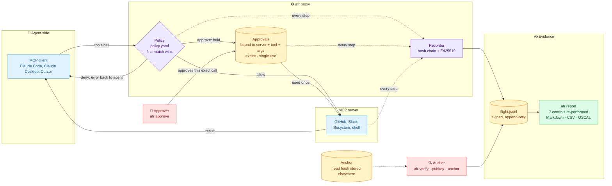
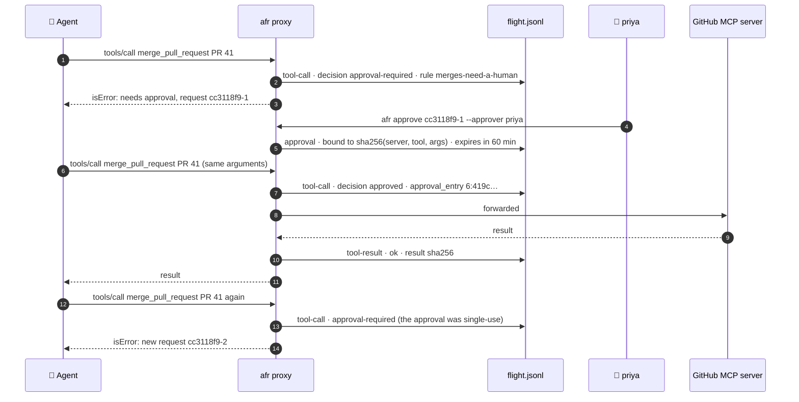
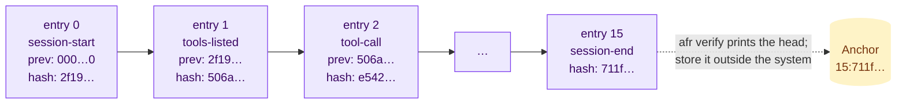

# agent-flight-recorder

**A flight recorder for AI agents: what did the agent actually do, who let it, and can you prove it?**

AI agents now call tools that merge code, move money and delete data. When something goes wrong, or an auditor asks, most teams can show what the agent *could* do (its permissions) but not what it *did*: which person it was acting for, which tool it called with which arguments, what the policy said, and who approved the risky step. Ordinary application logs can't answer that well, because whoever runs the agent can also edit the logs.

`agent-flight-recorder` (`afr`) sits between an agent and its [MCP](https://modelcontextprotocol.io) tool servers and does three things:

1. **Enforces policy on every tool call.** Rules written as code allow a call, deny it, or hold it until a named human approves. Approvals are bound to the exact call (server, tool and arguments), expire, and work once.
2. **Records every call in a tamper-evident log.** Each entry is hash-chained to the one before and signed with Ed25519. It records the agent, the person it acted for, the server, the tool, a digest (and optionally a redacted copy) of the arguments, the rule that decided, the approval it ran under, and the outcome.
3. **Turns the log into audit evidence.** `afr report` re-checks the chain and signatures and re-performs seven controls against the log. It then writes a reviewer report, a CSV of every call, hashed evidence JSON and OSCAL assessment results.

```bash
pip install git+https://github.com/Mihirajmera/agent-flight-recorder
afr demo
```

```
AFR-01  LOW     1 finding(s)
AFR-02  PASS    0 finding(s)
AFR-03  PASS    0 finding(s)
AFR-04  MEDIUM  1 finding(s)
AFR-05  PASS    0 finding(s)
AFR-06  MEDIUM  1 finding(s)
AFR-07  PASS    0 finding(s)

Tampered copy (one "deny" changed to "allow"): chain BROKEN
  - entry 4: content does not match its hash (edited after it was written)
```

The demo runs a scripted session for a release agent working through the GitHub MCP server. The agent reads a pull request, is blocked from pushing to `main`, and waits for priya to approve a merge. Its retry needs a fresh approval, because approvals are single-use. Then dana approves her own agent's branch deletion, and the server quietly changes a tool description. Read the [sample report](sample-output/evidence/flight-report.md) and the [signed log](sample-output/flight.jsonl) without installing anything.

> [agent-access-review](https://github.com/Mihirajmera/agent-access-review) answers *what can this agent do?* This tool answers *what did it do?*

## How it works



The agent and the server don't change. The proxy speaks MCP to both, so the agent sees the same tools, and the server sees only the calls the policy let through.

### An approval, step by step



### Why the log is tamper-evident



Each entry stores the hash of the one before it and its own hash, and the recorder signs that hash with Ed25519. Editing, deleting or reordering any entry breaks every link after it. Without the private key, nobody can write a replacement chain that verifies. The anchor catches the one thing a chain can't: entries cut off the end.

## Run an MCP server behind the recorder

Write a policy:

```yaml
# policy.yaml
agent: release-bot
on_behalf_of: env:USER                 # the person running the agent, or a literal name
default: approve                       # anything not listed needs a human
record_arguments: redacted             # digest | redacted | full
approval_ttl_minutes: 60

rules:                                 # first match wins
  - id: read-only
    tools: ["get_*", "list_*", "search_*"]
    decision: allow

  - id: no-push-to-protected
    tools: ["push_files", "create_or_update_file"]
    when: {arg: branch, matches: "^(main|master|release/.*)$"}
    decision: deny
    reason: Agents don't write to protected branches; open a pull request instead.

  - id: merges-need-a-human
    tools: ["merge_pull_request", "delete_*"]
    decision: approve
```

Create a signing key:

```bash
afr keygen --out afr-signing
```

That writes `afr-signing.key` (keep it secret) and `afr-signing.pub`. Then point your MCP client at `afr proxy` instead of the server. For example, in a Claude Code `.mcp.json` or a Claude Desktop config:

```json
{
  "mcpServers": {
    "github": {
      "command": "afr",
      "args": ["proxy", "--policy", "policy.yaml", "--key", "afr-signing.key", "--server-name", "github",
               "--", "npx", "-y", "@modelcontextprotocol/server-github"],
      "env": {"GITHUB_PERSONAL_ACCESS_TOKEN": "..."}
    }
  }
}
```

The agent sees the same tools as before. A denied call returns an error the agent can relay, carrying the rule's reason. A call that needs approval returns a request ID and never reaches the server until someone approves it:

```bash
afr pending --log .afr/release-bot.jsonl
```

```bash
afr approve 3f9c2a1b-1 --approver priya@example.com --log .afr/release-bot.jsonl --key afr-signing.key
```

The agent's next identical call goes through once. A call with different arguments, a second retry, or a retry after the TTL needs a new approval.

## Verify and report

```bash
afr verify --log .afr/release-bot.jsonl --pubkey afr-signing.pub
```

```
16 entries; chain intact; 16 signed
Head: 15:711fe81a...  (store it elsewhere; pass it later as --anchor)
```

```bash
afr report --log .afr/release-bot.jsonl --pubkey afr-signing.pub --anchor 15:711fe81a... --out evidence --fail-on medium
```

`report` does not trust the log's own claims. It recomputes every hash and signature. It also checks every recorded decision against the policy that was in force for that session, follows every approval reference back to a real, earlier, unexpired approval entry for the same call, and counts how many times each approval was used.

| Check | Control | What fails it |
|---|---|---|
| AFR-01 | The flight log is complete and unaltered | an edited, removed or reordered entry; a bad signature; the anchored entry missing; no signing key at all |
| AFR-02 | Every tool call is attributed to an agent and the person it acts for | a call with no agent or no `on_behalf_of` |
| AFR-03 | Calls that need approval ran only with a valid, single-use human approval | a call claiming a missing, later or rejected approval; an approval for different arguments; one used twice or after it expired |
| AFR-04 | Nobody approved an agent acting on their own behalf | the approver is the person the agent was acting for |
| AFR-05 | Policy decisions were enforced | a decision that contradicts its rule; a denied call that has a result, meaning it reached the server |
| AFR-06 | Tool definitions did not change without review | a tool's description or input schema hash changed between listings (a possible tool-poisoning "rug pull") |
| AFR-07 | Every forwarded call has a recorded outcome | an allowed call with no result |

Each check is mapped to NIST SP 800-53, SOC 2, ISO/IEC 42001 Annex A and the EU AI Act in [`controls.yaml`](agent_flight_recorder/controls.yaml). The mappings are my judgment; check them against official crosswalks before relying on them in an audit. The tool produces evidence that is *relevant to* the AI Act's record-keeping (Article 12) and human-oversight (Article 14) duties. It does not by itself make a system compliant with them.

## What it records, and what it doesn't

- **Arguments:** `digest` keeps only a SHA-256. `redacted` (the default) also keeps a copy with secret-looking keys removed and long strings cut to 500 characters. `full` keeps everything. Every mode records the digest, so an approval can be bound to the exact call.
- **Results:** whether the call succeeded, the error code, the duration and a SHA-256 of the result. Never the result body, which may hold the very data you are protecting.
- **Tool listings:** each tool's name plus hashes of its description and input schema, so changes show up without the log storing the text.
- **The server command:** the program name and a hash of the full command line, because arguments sometimes carry tokens.

## Limits

- **Truncation needs an anchor.** A hash chain shows edits, deletions and reordering in the middle of a log, but someone who can write the file can cut entries off the end. Store the `Head:` from `afr verify` somewhere the agent's operator can't change it (a ticket, a WORM bucket, a separate system), and pass it as `--anchor`. Reports without an anchor say so.
- **One signing key per log.** Whoever holds the private key can write a new, valid log. Keep the key away from the agent's host, or rotate it per session. Hardware or KMS-backed signing would be the next step.
- **stdio only.** It wraps MCP servers that speak JSON-RPC over stdin and stdout, which covers most local servers. Streamable HTTP servers aren't supported yet.
- **It sees the tool calls, not the model.** Prompts, reasoning and anything the agent does outside MCP (its own shell, direct API calls) are out of view. Pair it with sandboxing for those.
- **Approvals are command-line.** `afr approve` records who approved and when, but it trusts the `--approver` you type. In production, run approvals through a system that authenticates the approver and calls `afr approve` for them.

## Development

```bash
pip install -r requirements.txt
pytest -q
```

If a change alters the demo, regenerate the sample output (CI fails if it is stale):

```bash
SOURCE_DATE_EPOCH=1791763200 python -m agent_flight_recorder demo --out sample-output
```

CI runs the tests, rebuilds the sample output and fails if it changed, checks the wheel, and runs CodeQL, OpenSSF Scorecard and ClusterFuzzLite. The fuzz target feeds arbitrary bytes to the log verifier, the report and the policy loader. Releases carry SLSA provenance.

MIT licensed. Security reports: see [SECURITY.md](SECURITY.md).
